# OpenGlance Clock

**Your own software for the Glance Clock.** Control it from any web browser through a tiny ESP32-C3 bridge that lives inside the clock, or connect directly from a Mac or Windows PC over Bluetooth. No Glance account, no cloud, no phone app.

  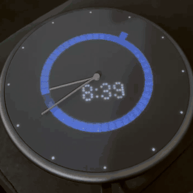
  &nbsp;
  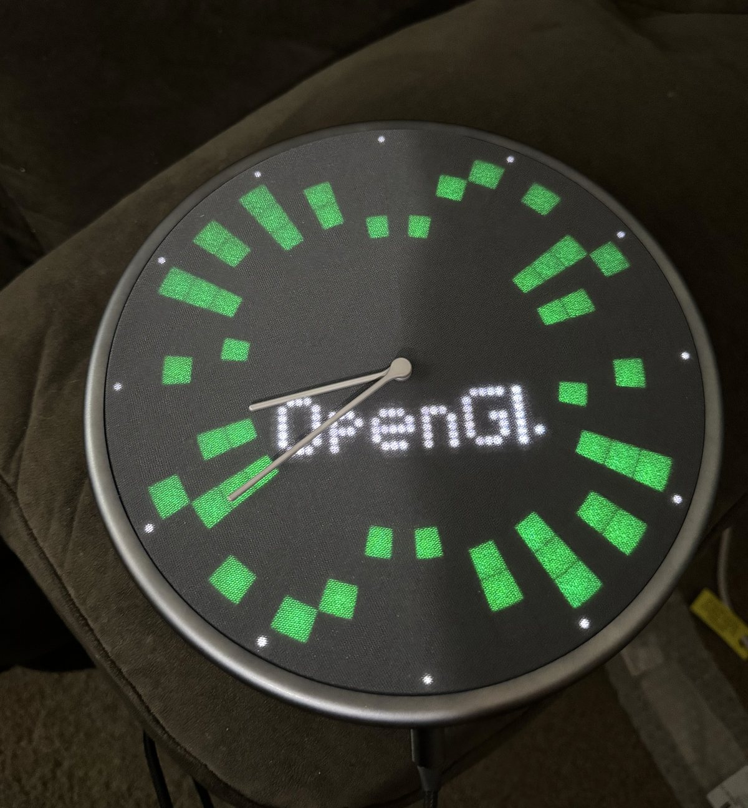

<em>After start-up the bridge connects to the clock and announces itself: “OpenGlance 1.10 connected”.</em>

---

## The three pieces

| | What it is | Runs on | Talks to the clock |
| --- | --- | --- | --- |
| **[OpenGlance Bridge](#1-openglance-bridge-esp32-c3-firmware)** | Firmware for an ESP32-C3 Super Mini, built into the clock | ESP32-C3 | Bluetooth LE, all day, every day |
| **[OpenGlance Clock](#2-openglance-clock-mac-and-windows-app)** | Desktop app for an **unmodified** Glance Clock | macOS 14+ (Apple silicon), Windows 10/11 | Bluetooth LE from the computer |
| **[OpenGlance Flasher](#3-openglance-flasher)** | Installs the bridge firmware on a bare ESP32-C3 over USB | macOS, Windows | — (flashes the ESP32-C3) |

**Downloads:** see **[Releases](../../releases/latest)** for the Mac apps, the Windows `.exe` files and the bridge firmware `.bin`.

---

## 1. OpenGlance Bridge (ESP32-C3 firmware)

The Glance Clock only speaks Bluetooth LE. The bridge is an ESP32-C3 that sits **inside the clock**, stays connected to it over Bluetooth, and joins your home Wi-Fi. That gives you:

- **Control from any web browser.** Phone, tablet or computer: open `http://openglance.local/`. No app to install.
- **A clock that is permanently online.** It gets internet time and weather automatically, with nothing else needing to be switched on.
- **Exact time, all the time.** The bridge takes time from NTP and hands it to the clock through the standard Bluetooth *Current Time Service*, which the clock reads every time it connects. It re-syncs daily at 03:05 and whenever daylight saving starts or ends. Time zones are POSIX rules, so DST switches automatically.

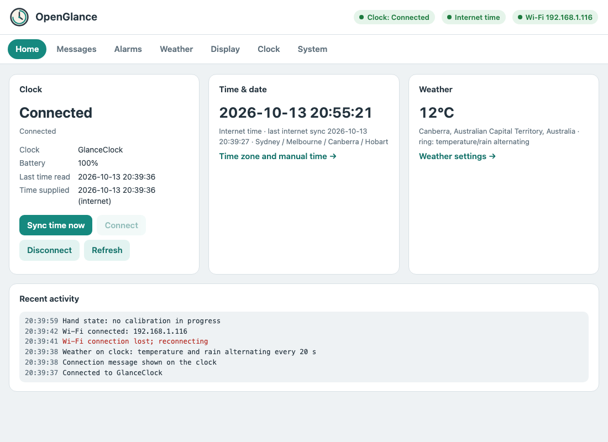

### Features

| Tab | What you can do |
| --- | --- |
| **Home** | Connection, battery, the time last read by the clock and the exact value supplied, weather summary, **Sync time now**, recent activity |
| **Messages** | Send scrolling text with an animation (Pulse, Wave, Fire, Wheel, Flower, Sun, Cloud), a colour and any of the 17 built-in sounds (each with **Test**). Start/stop timers. **Hourly chime** with your choice of sound and quiet hours |
| **Alarms** | Up to 4 alarms with days (Weekdays, Weekend, Every day, Once or any mix), sound and a 16-character label. **Stop the alarm now**, **Delete all alarms on the clock** |
| **Weather** | A 24-hour **temperature ring** coloured blue → green → amber → red, and a **rain ring** shown only when rain is really coming (amount *and* chance within a look-ahead you choose). Alternates the two rings on an interval, or shows rain instead. Place search, 12-hour preview. Data from [Open-Meteo](https://open-meteo.com) |
| **Display** | Digital time, 12/24-hour, hour points, night mode, mute, date format, and brightness: **automatic with minimum/maximum limits**, or fixed |
| **Clock** | Find and pair a clock (type the PIN it shows), automatic reconnection, the optional silent “OpenGlance connected” message, and **hand calibration** with a reseating guide |
| **System** | Time zone and manual time, Wi-Fi, **firmware update over Wi-Fi** (files are checked before installing), full activity log |

<table>
<tr>
<td>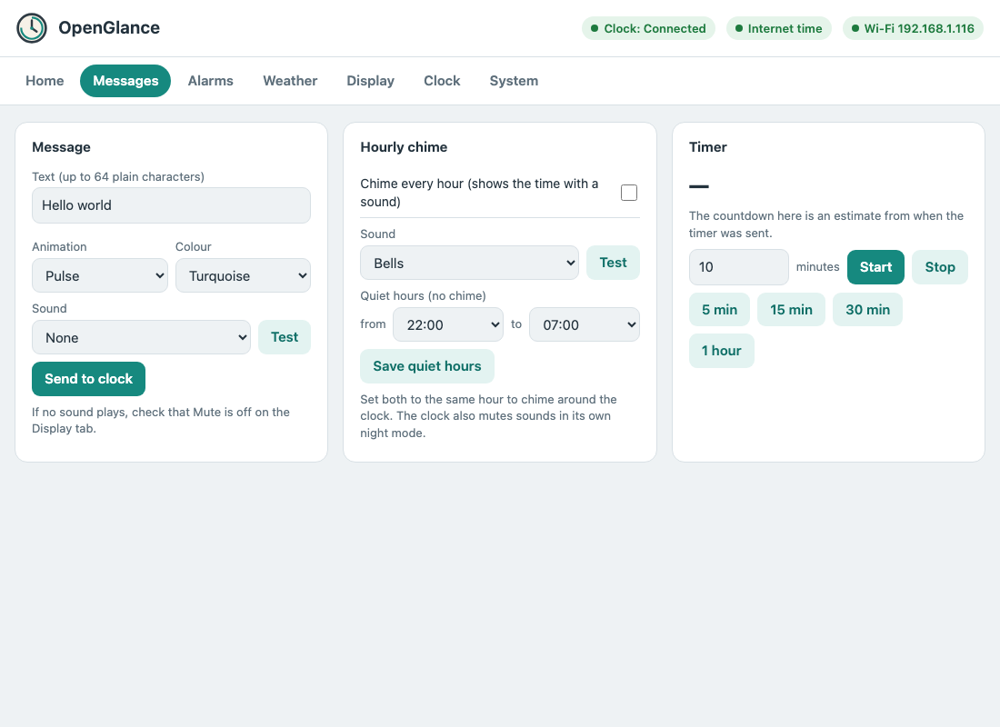</td>
<td>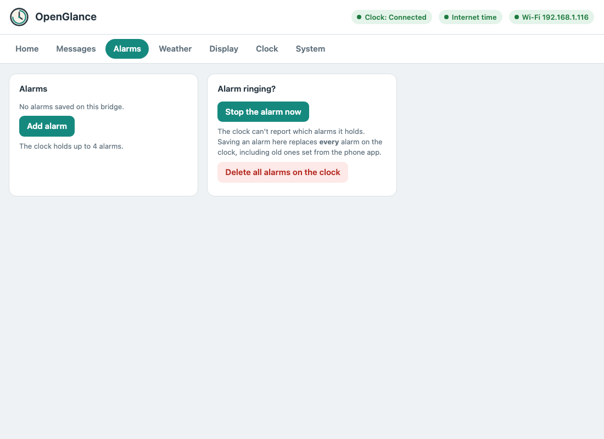</td>
</tr>
<tr>
<td>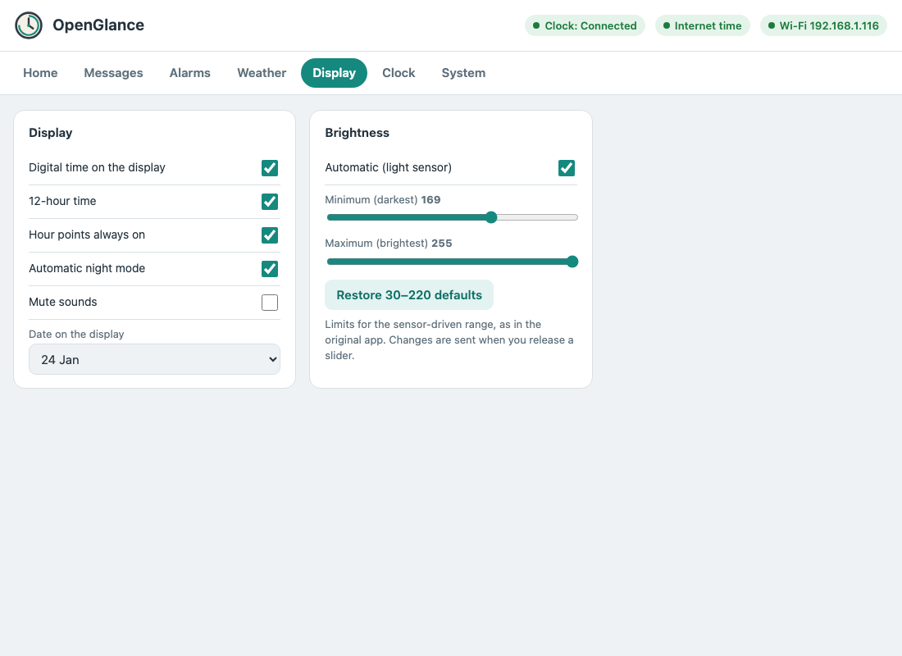</td>
<td>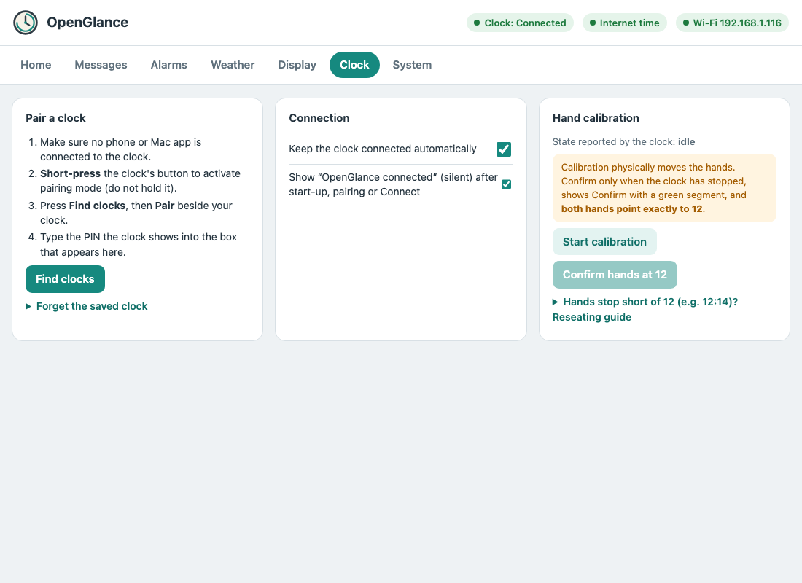</td>
</tr>
</table>

<table>
<tr>
<td width="68%">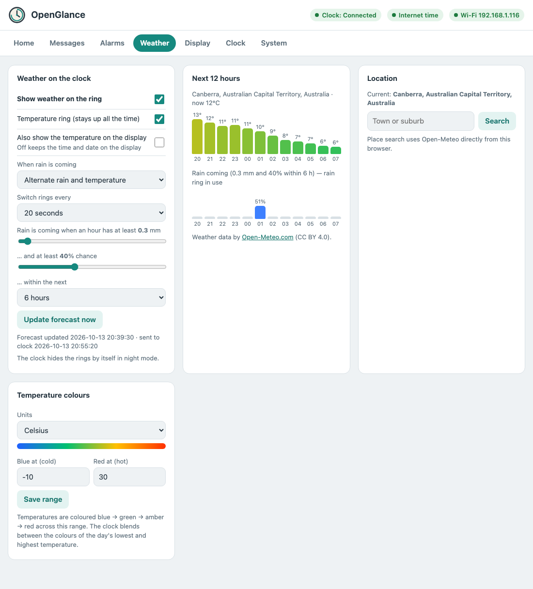</td>
<td>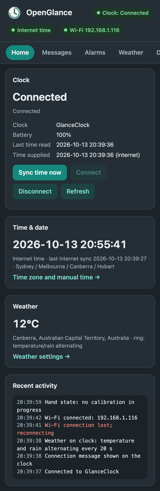 <em>Works on a phone too, in light or dark mode.</em></td>
</tr>
</table>

### Setting it up

1. **Flash the ESP32-C3** with [OpenGlance Flasher](#3-openglance-flasher), or upload a newer `OTA.bin` from the bridge's own web page later.
2. **Wi-Fi:** the bridge opens a hotspot called **OpenGlance-Setup**. Join it, pick your 2.4 GHz Wi-Fi from the list, enter its password and choose your time zone.
3. **Open `http://openglance.local/`** (or the IP address your router shows).
4. **Pair the clock:** close any phone app or desktop app that is connected to the clock (it accepts one connection at a time). **Short-press** the clock's button (don't hold it), press **Find clocks → Pair**, and type the PIN the clock shows.

From then on the bridge keeps the clock connected and reconnects by itself. If the saved Wi-Fi stops working, the setup hotspot comes back after 2 minutes.

> The bridge page has no login (owner's choice), so anyone on your home network can use it. Firmware uploads are still validated: only OpenGlance bridge firmware built for the ESP32-C3 is accepted.

---

## The hardware mod: an ESP32-C3 in place of the barrel jack

The Glance Clock is powered from a 5 V DC barrel jack. The mod swaps that jack for an **ESP32-C3 Super Mini**, so the bridge lives inside the clock and its USB-C port becomes the clock's power input.

1. **Remove the DC barrel jack** from the clock's main board.
2. **Widen the hole** in the case where the jack was, so the Super Mini's USB-C connector fits through it.
3. **Mount the ESP32-C3** behind the hole (here with hot glue), USB-C facing out.
4. **Run two wires** from the ESP32-C3's **5V** and **GND** pins to the clock's 5 V input: the pads the barrel jack used to occupy.

That's all. The bridge does **not** connect to any of the clock's logic; it only shares its power. Everything else happens over Bluetooth. A single USB-C cable now powers the clock, charges its battery, runs the bridge, and lets you re-flash the bridge from a computer without opening anything.

<table>
<tr>
<td width="50%">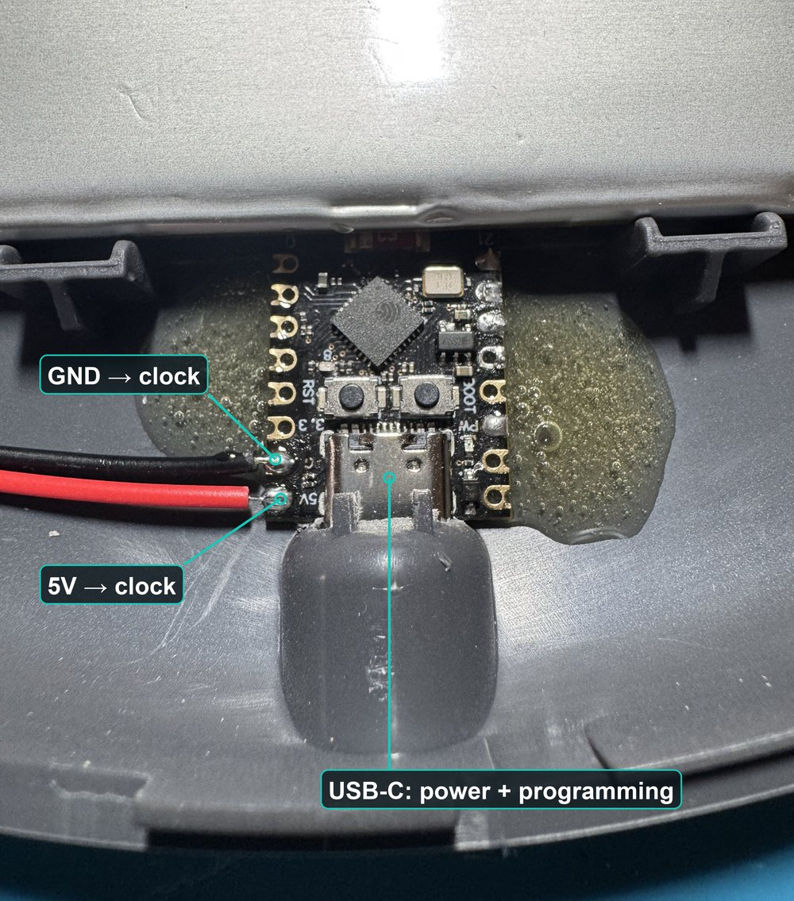</td>
<td width="50%">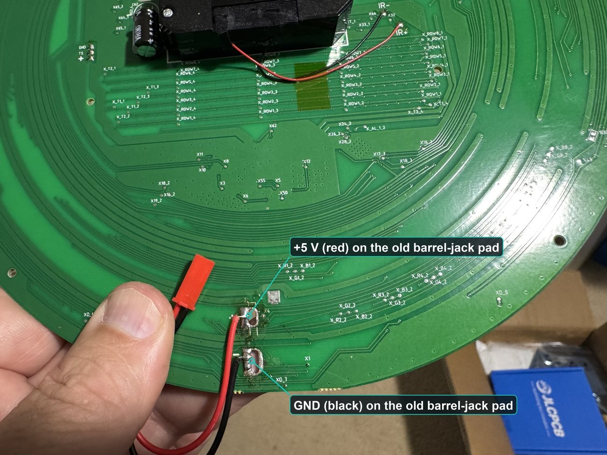  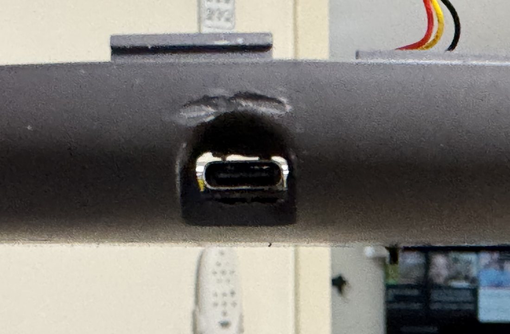</td>
</tr>
<tr>
<td><em>The ESP32-C3 Super Mini in place of the barrel jack.</em></td>
<td><em>5 V (red) and GND (black) on the old jack pads, and the USB-C port in the widened hole.</em></td>
</tr>
</table>

**Before you copy this:**
- The clock's original supply is **5 V, 1.5 A**. Use a USB power supply that can deliver at least 2 A.
- Check your board: some Super Mini variants put a diode between USB VBUS and the `5V` pin. If yours does, take the clock's power from VBUS instead.
- Double-check polarity with a multimeter before connecting the battery and powering up.
- Keep the ESP32-C3's antenna clear of metal so it still reaches your Wi-Fi.

---

## 2. OpenGlance Clock (Mac and Windows app)

For a Glance Clock **without** the bridge. The app connects straight to the clock over your computer's Bluetooth and has the same look and features as the bridge's web page: messages and sounds, timers, hourly chime, alarms, weather rings, display and brightness settings, pairing, auto-connect and hand calibration.

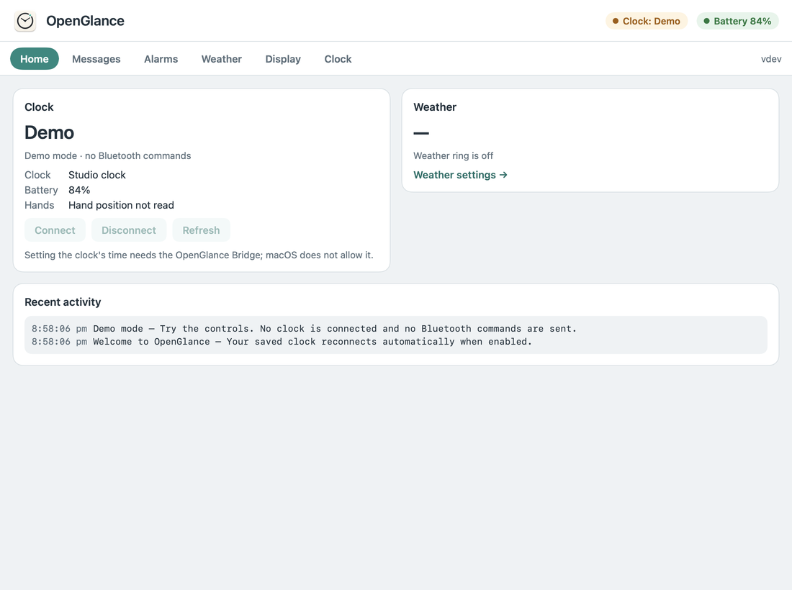

### Setting the time without the time service

A computer can't set the clock's time the way the bridge does. macOS doesn't let apps publish the Bluetooth Current Time Service, and the clock can't report its own time. So the Mac app uses a **hidden time-offset setting found in the clock's firmware** (Settings field 18, firmware 1.6.7 or later). Changing that offset moves the clock's running time by the difference.

- **Set** the clock to this computer's time, or type any time (and date) you want.
- **Fine adjust** with ±1 minute and ±1 hour buttons.
- The app estimates what the clock currently shows (from the bridge's last sync plus every change made since). If the clock shows something else, type the time it actually shows and the app remembers the correction.
- Before going back to the bridge, **Reset offset to 0**, because the clock adds the offset to the time the bridge supplies.

<table>
<tr>
<td width="55%">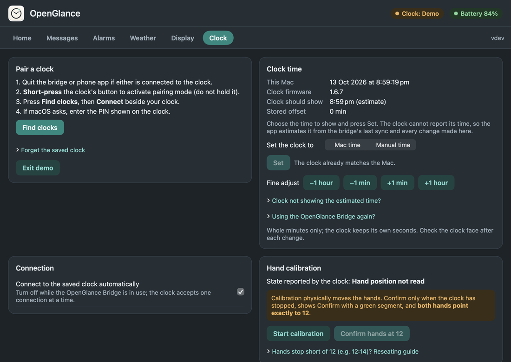</td>
<td>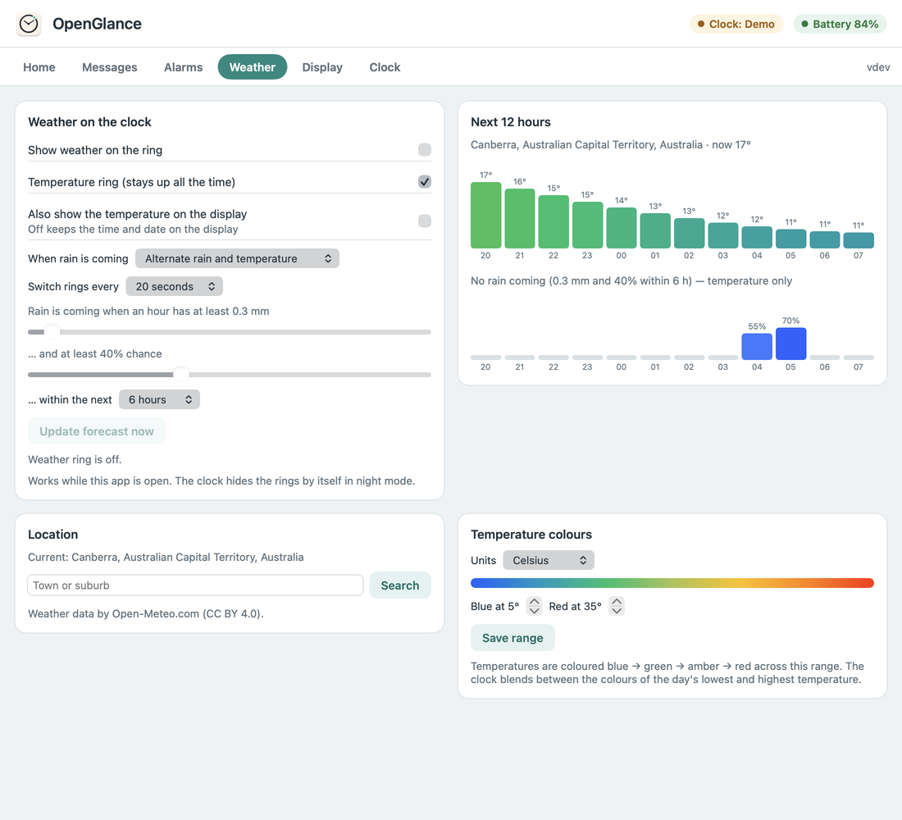</td>
</tr>
</table>

### Windows

The Windows version is a native rewrite with the same tabs and features, delivered as a single self-contained `.exe` (no .NET or drivers to install). It pairs the clock itself and asks for the PIN shown on the clock.

<table>
<tr>
<td>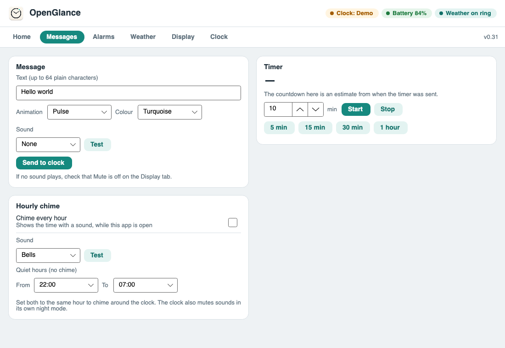</td>
</tr>
<tr>
<td>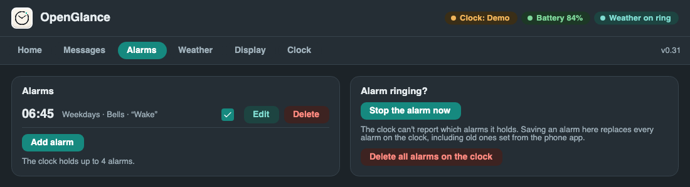</td>
</tr>
</table>

> **Status:** the Mac app has been tested on a real clock, including setting the time. The Windows app is a first build and has **not yet been tested with a real clock**. It needs a PC with Bluetooth LE; virtual machines (e.g. Parallels on Apple silicon) usually don't provide one.

---

## 3. OpenGlance Flasher

Installs `OpenGlance Bridge X.YY OTA.bin` onto an ESP32-C3 over USB, including a brand-new, empty board. Plug the board in, the Flasher finds its port and the newest firmware, press **Install firmware**. It writes the bootloader, partition table, boot selector and app together, verifies them, then waits for the bridge to report that it started.

- Rejects anything that isn't OpenGlance bridge firmware for the ESP32-C3 (including full images and other chips).
- **Erase the whole chip first** is optional; without it, the bridge keeps its Wi-Fi settings and clock pairing.
- Contains Espressif's official, unmodified [esptool](https://github.com/espressif/esptool) (GPLv2).

  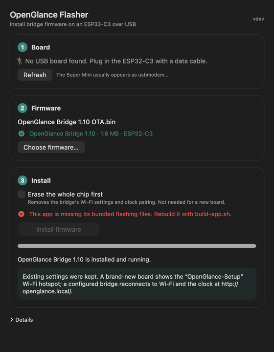
  &nbsp;
  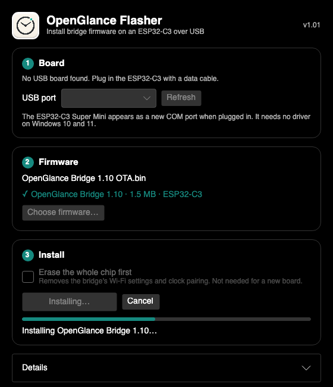

---

## Inside the Glance Clock

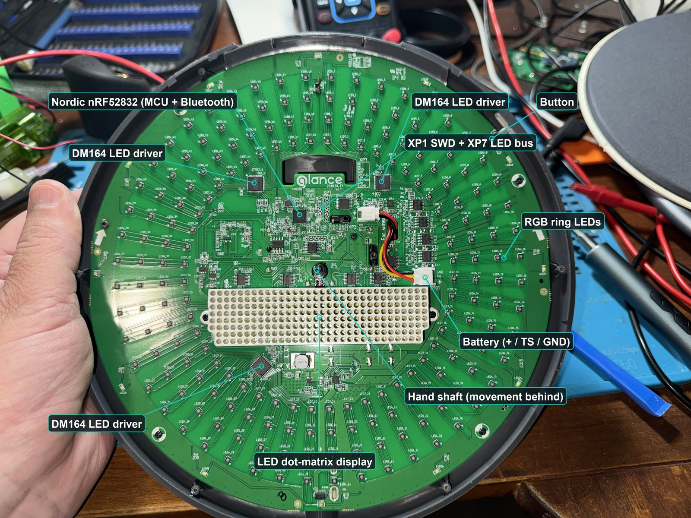

- **Brain:** a Nordic **nRF52832** (Bluetooth LE + Cortex-M4) with an external SPI flash.
- **LEDs:** three **DM164** LED drivers run the RGB ring and the white dot-matrix display.
- **Hands:** a separate stepper movement with an **IR sensor** finds the 12 o'clock reference during calibration.
- **Board:** “glance 2018.04.13 v6.1”, with an unpopulated SWD header (XP1). Nothing in this project flashes or modifies the clock's own firmware.

<table>
<tr>
<td>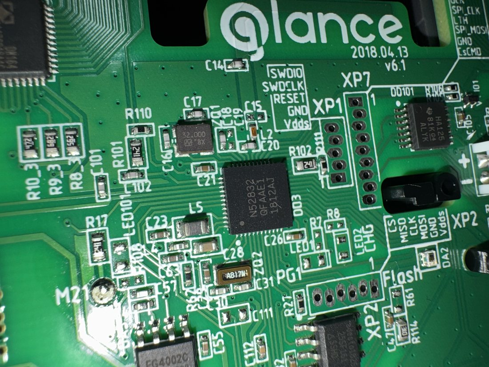 <em>nRF52832 and the XP1 SWD header.</em></td>
<td>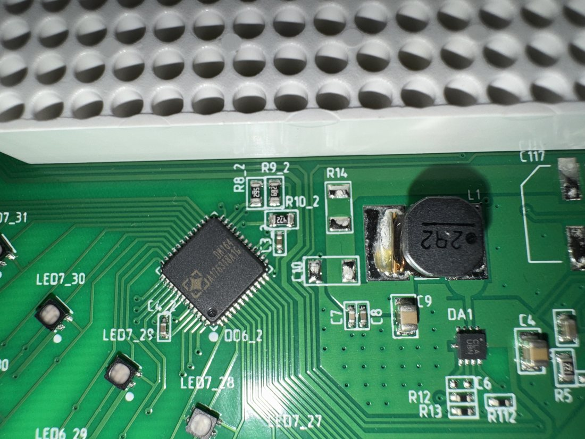 <em>One of the three DM164 LED drivers.</em></td>
</tr>
<tr>
<td>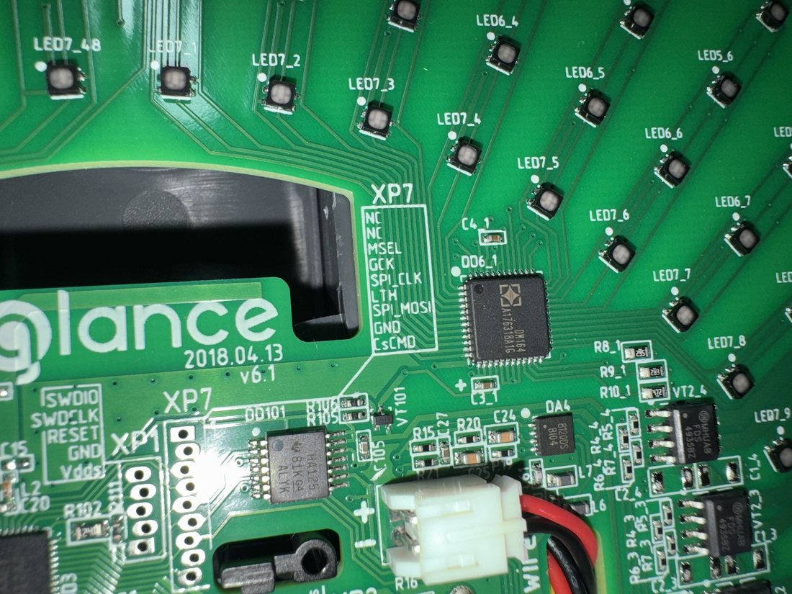 <em>XP7 LED-bus header next to a DM164.</em></td>
<td>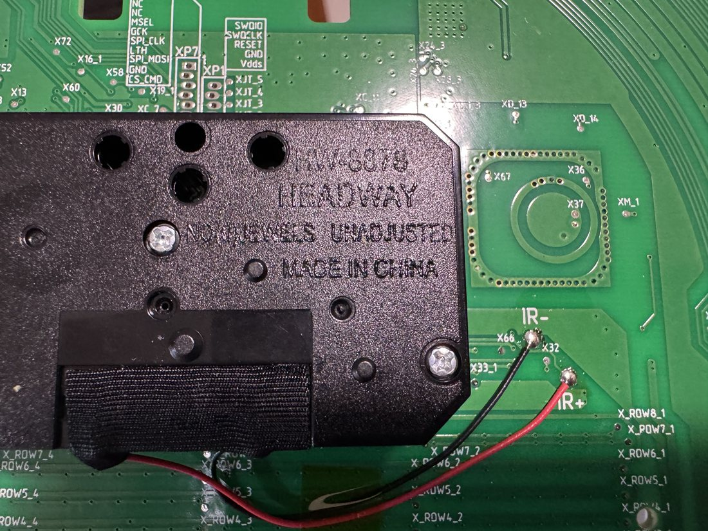 <em>The hands' movement and its IR homing sensor.</em></td>
</tr>
<tr>
<td>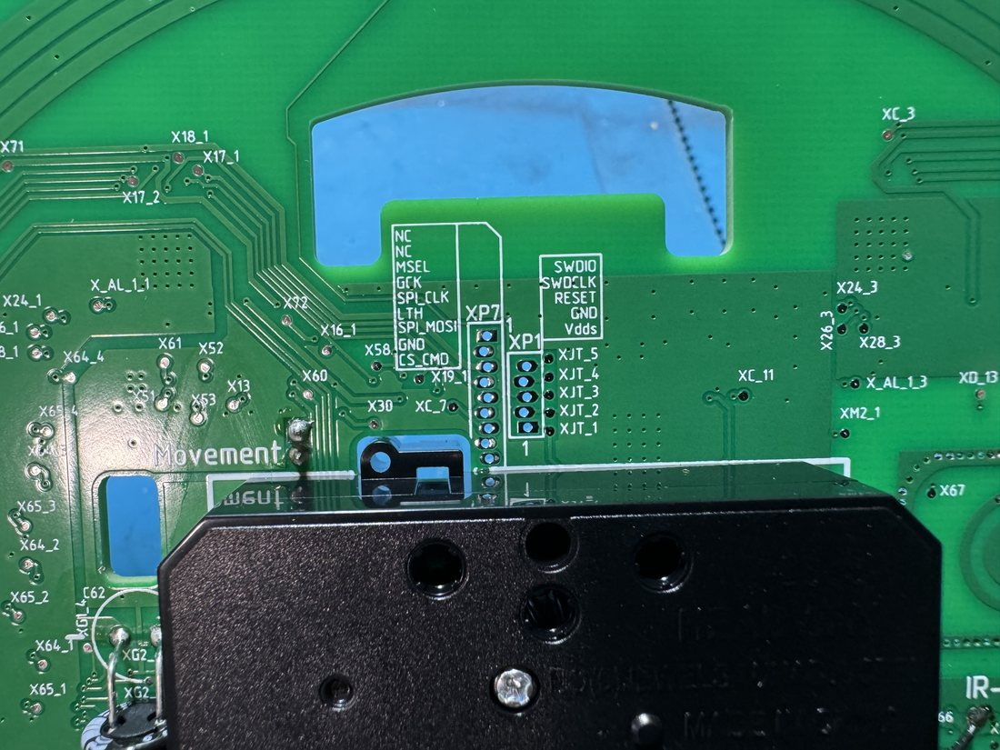 <em>Back of the board.</em></td>
<td>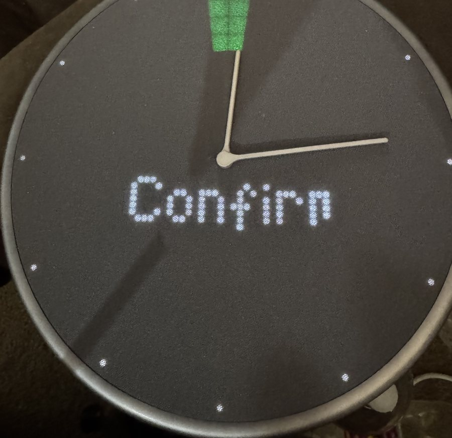 <em>Hand calibration: confirm only when both hands point exactly to 12.</em></td>
</tr>
</table>

---

## Building from source

| Piece | Folder | Build |
| --- | --- | --- |
| Bridge firmware | [`Code/ESP32C3`](Code/ESP32C3) | `bash build.sh` (arduino-cli, `esp32:esp32` 3.3.12 core, NimBLE-Arduino 2.5.1). Runs host-side protocol checks first. |
| OpenGlance Clock for Mac | [`Code/OpenGlanceClock`](Code/OpenGlanceClock) | `bash build-app.sh` (Swift, Command Line Tools are enough) |
| OpenGlance Flasher for Mac | [`Code/OpenGlanceFlasher`](Code/OpenGlanceFlasher) | `bash build-app.sh` (needs the ESP32 Arduino core's esptool) |
| Windows apps | [`Code/Windows`](Code/Windows) | `bash build.sh` on a Mac with the .NET 8 SDK; produces both `.exe` files |

Each build script runs its own checks (protocol packets, settings preservation, firmware validation and more) before producing anything, and never overwrites an older release. Mac and Windows apps always share version numbers.

---

## How it works, and thanks

The Glance Clock's Bluetooth protocol was documented by others first. This project builds on:

- [Hypfer/glance-clock](https://github.com/Hypfer/glance-clock): the reverse-engineered protobuf schema and commands
- [PorlyBe/glance_clock_ha](https://github.com/PorlyBe/glance_clock_ha) and [Snille/glance_clock_ha](https://github.com/Snille/glance_clock_ha): Home Assistant integrations, including hardware-tested forecast scenes and brightness handling
- [PorlyBe/bluetooth-cts](https://github.com/PorlyBe/bluetooth-cts): the clock reads time from a Current Time Service on the connected device

New in OpenGlance, from static analysis of the original app and the clock's firmware: the automatic-brightness minimum/maximum encoding, the alarm list format, the hand-calibration state flags, and the hidden time-offset setting that lets a Mac set the time.

Settings are always read from the clock first, unknown fields are preserved, and every change is read back to confirm it. Nothing here flashes or alters the clock's own firmware.

---

*OpenGlance is an independent hobby project, not affiliated with or endorsed by Glance. Opening and modifying your clock is at your own risk.*
